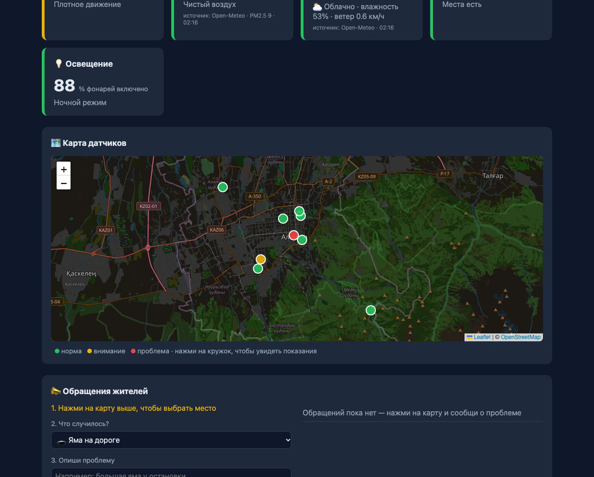
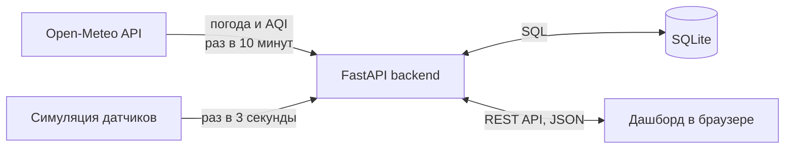

<div align="center">

# 🏙️ Smart City Dashboard

**Панель мониторинга «умного города» Алматы в реальном времени**

[](https://github.com/Gadilova/smart-city/actions/workflows/tests.yml)
[](LICENSE)




</div>

## О проекте

Backend на Python (FastAPI) собирает показания датчиков города, хранит их в SQLite и отдаёт через свой REST API. Дашборд в браузере каждые 3 секунды берёт с него свежие данные и обновляет карточки, карту и график.

Погода и качество воздуха — **настоящие**, из бесплатного API [Open-Meteo](https://open-meteo.com/). Трафик, парковки и освещение симулируются на сервере; трафик повторяет «типичный день» города с часами пик.

## ✨ Возможности

| | Модуль | Что показывает |
|---|--------|----------------|
| 🚦 | Трафик | Машин в минуту с часами пик утром и вечером, предупреждение о пробках |
| 🔮 | Прогноз трафика | Трафик на 6 часов вперёд по средним значениям прошлых наблюдений в эти часы |
| 🌫️ | Качество воздуха | Индекс AQI и PM2.5 (Open-Meteo) |
| 🌡️ | Погода | Температура, влажность, ветер (Open-Meteo) |
| 🅿️ | Парковки | Свободные места на трёх парковках |
| 💡 | Освещение | Автоматический ночной и дневной режим |
| 🗺️ | Карта датчиков | 9 датчиков на карте Leaflet с цветом статуса |
| 📈 | История | График последних показаний (Chart.js) |
| 📣 | Обращения жителей | Выбери место на карте, опиши проблему (яма, фонарь, мусор), диспетчер отмечает «Решено» |

Каждый показатель получает статус: 🟢 норма · 🟡 внимание · 🔴 проблема.

## 🏗️ Как это устроено



## 🚀 Как запустить

Нужен Python 3.9 или новее.

```bash
git clone https://github.com/Gadilova/smart-city.git
cd smart-city/backend
python3 -m venv .venv                     # виртуальное окружение (один раз)
.venv/bin/pip install -r requirements.txt # библиотеки (один раз)
.venv/bin/uvicorn main:app --reload       # запуск сервера
```

Потом открой:
- http://localhost:8000 — дашборд
- http://localhost:8000/docs — документация API, где можно отправлять запросы прямо из браузера

Остановить сервер: `Ctrl+C` в терминале.

> Дашборд работает только вместе с backend: если открыть `index.html` напрямую, данных не будет.

## 🧪 Тесты

Автотесты проверяют правила статусов, прогноз и все адреса API. Каждый тест работает со своей временной базой, настоящая `smart_city.db` не трогается.

```bash
cd backend
.venv/bin/pip install -r requirements-dev.txt  # pytest и httpx (один раз)
.venv/bin/python -m pytest -v
```

После каждого push GitHub Actions запускает тесты сам, на Python 3.9 и 3.12. Результат виден во вкладке **Actions** и на значке **Tests** вверху.

## 🔌 API

| Метод и адрес | Что делает |
|---------------|-----------|
| `GET /api/city` | Сводка по городу для карточек и погода |
| `GET /api/sensors` | Все датчики с последними показаниями |
| `GET /api/history?limit=20` | История сводок для графика |
| `GET /api/forecast?hours=6` | Прогноз среднего трафика на 1–12 часов |
| `GET /api/reports` | Обращения жителей: сначала новые |
| `POST /api/reports` | Создать обращение: `{"category": "road", "description": "...", "lat": 43.24, "lon": 76.93}` |
| `PATCH /api/reports/{id}/resolve` | Отметить обращение решённым |

## 📁 Структура

```
smart-city/
├── backend/
│   ├── main.py            # сервер FastAPI: адреса API и фоновые задачи
│   ├── sensors.py         # датчики, симуляция и правила статусов
│   ├── forecast.py        # прогноз трафика по часам
│   ├── open_meteo.py      # загрузка настоящей погоды и воздуха
│   ├── database.py        # работа с SQLite (smart_city.db)
│   ├── tests/             # автотесты pytest
│   ├── requirements.txt   # библиотеки Python
│   └── requirements-dev.txt  # библиотеки для тестов
├── frontend/
│   ├── index.html         # разметка: карточки, карта, обращения, график, журнал
│   ├── style.css          # оформление и цвета статусов
│   └── app.js             # запросы к API и обновление страницы
├── docs/
│   └── screenshot.png     # скриншот для README
└── .github/
    ├── workflows/tests.yml   # GitHub Actions: запуск тестов
    └── ISSUE_TEMPLATE/       # шаблоны для ошибок и идей
```

## 🗺️ Планы

- [x] Графики истории (Chart.js)
- [x] Карта города (Leaflet)
- [x] Backend на FastAPI и база данных SQLite
- [x] Frontend берёт данные из backend вместо своей симуляции
- [x] Обращения жителей (POST / PATCH, проверка данных, защита от XSS)
- [x] Прогноз трафика по часам (сезонная модель)
- [x] Автотесты и GitHub Actions
- [ ] Сравнить прогноз с ML-моделью (scikit-learn)
- [ ] Деплой в интернет

---

<div align="center">

Учебный проект · [Aiganym Gadilova](https://github.com/Gadilova) · лицензия [MIT](LICENSE)

</div>
